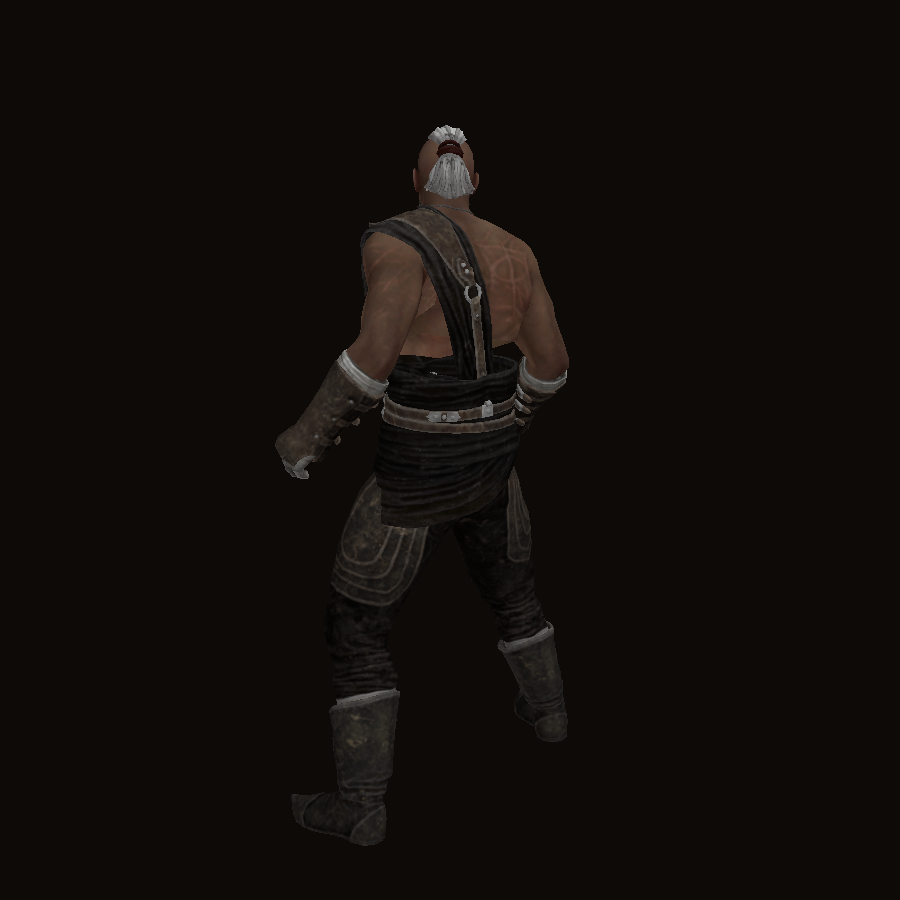
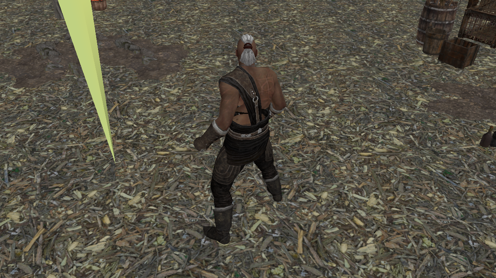
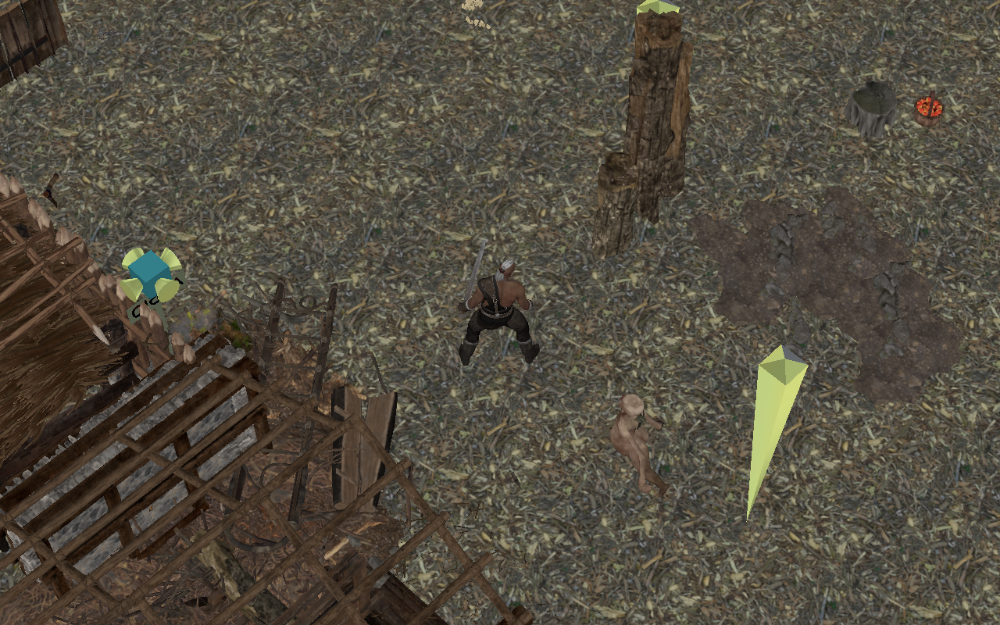
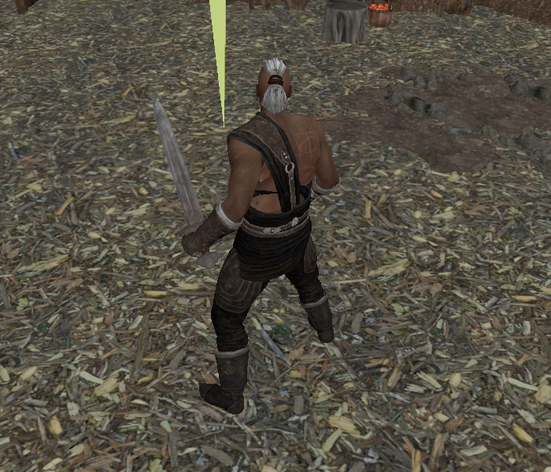

# openPOE2

An independent, from-scratch Rust engine that reads a legitimately installed copy of
Path of Exile 2 and aims to run it fully offline. Early development.

**Not affiliated with Grinding Gear Games.** "Path of Exile" and related names are trademarks of
their owners. This repository contains no game content: you need your own installed copy, which is
only ever read. The project never connects to official servers and does not touch anti-cheat.

## Screenshots

Rendered offscreen by `viewer` from a local install (game art belongs to Grinding Gear Games; shown here for documentation of the reimplementation).

| Animated character | Exile Encampment (play mode, textured ground) |
|---|---|
|  |  |

| Sandbox combat (animated monster from the game files) | Sword on the character |
|---|---|
|  |  |

Play mode uses a fixed isometric camera (45 degree yaw, true-isometric pitch, 20 degree lens; the exact values of the real game camera are not in the data files, so these are estimates). (`viewer <Bundles2> metadata/characters/str/strfourb.ao --world <room.arm>`): WASD to run, Space to attack, simple collision with tall room objects, a training monster that chases and strikes. With `POE2_SCHEMA=<dat-schema dir>` the player's life and unarmed damage come from the `Characters` table and the monster's life and damage from `DefaultMonsterStats` x `MonsterVarieties` (level via `POE2_MON_LEVEL`); without it, and for movement speeds and strike timing, the numbers are invented placeholders. Rooms use real terrain tiles matched by size and edge types (edge order N, E, S, W); `POE2_NO_TILES=1` falls back to flat ground. Known gaps: `.tdt` grids (heights, walkability) are parsed but not interpreted, zone generation is only a rough `.tgr` preview, no skills or items.

## What works

- `Bundles2` reader: Oodle (Leviathan) decompression via the pure-Rust `oozextract`, index with ~4.27 M files.
- `.datc64` table reader with schema validation. 549 of 568 tables with a community schema decode fully.
- `dds2png` / `icongrid`: texture decoding (BC-compressed DDS) and icon sheets built from table columns.
- `meshview` / `meshcheck`: mesh loading for `.fmt` (v4-9) and `.smd` (v1-3) models with a software preview renderer that applies `.mat` materials and base-colour textures. Format notes: [poe_data_tools](https://github.com/adamthedash/poe_data_tools) (MIT/Apache-2.0).
- `viewer`: wgpu model viewer (drag to orbit, wheel to zoom, Space toggles rotation; `--screenshot out.png` renders offscreen). Pass `@filter` instead of a path to browse every matching model: Left/Right step, PageUp/PageDown jump by 10, Home/End. Skinned meshes get their materials from the companion `.sm`; a terrain tile (`.tgt`) is assembled from its `.tgm` sub-tiles; a room (`.arm`) is shown as a ground plane with its doodads (`.ao` -> mesh) placed on it; a character `.ao` (e.g. `metadata/characters/str/strfourb.ao`) is assembled in its rest pose from the skinned body, outfit pieces and bone/socket attachments (skeleton from `.ast`).
- Server-side behaviour is not stored in the client, so gameplay will be a reconstruction, not an exact copy.

## Usage

```
cargo build --release
# list / extract files
poe2_bundles "<game>/Bundles2" data/balance/
poe2_bundles "<game>/Bundles2" data/balance/mods.datc64 mods.datc64
# bulk-extract tables
poe2_bundles "<game>/Bundles2" --extract-prefix data/balance/ out/ .datc64
# check / dump tables (needs a checkout of https://github.com/poe-tool-dev/dat-schema)
datdump <dat-schema>/dat-schema --check out/
datdump <dat-schema>/dat-schema out/mods.datc64 2
```

`schema_overrides.txt` holds row-layout fixes for the supported game build (build 26261440).
Table schemas come from the MIT-licensed community project
[dat-schema](https://github.com/poe-tool-dev/dat-schema) and are not vendored here.

## License

AGPL-3.0-only. See `LICENSE`.
